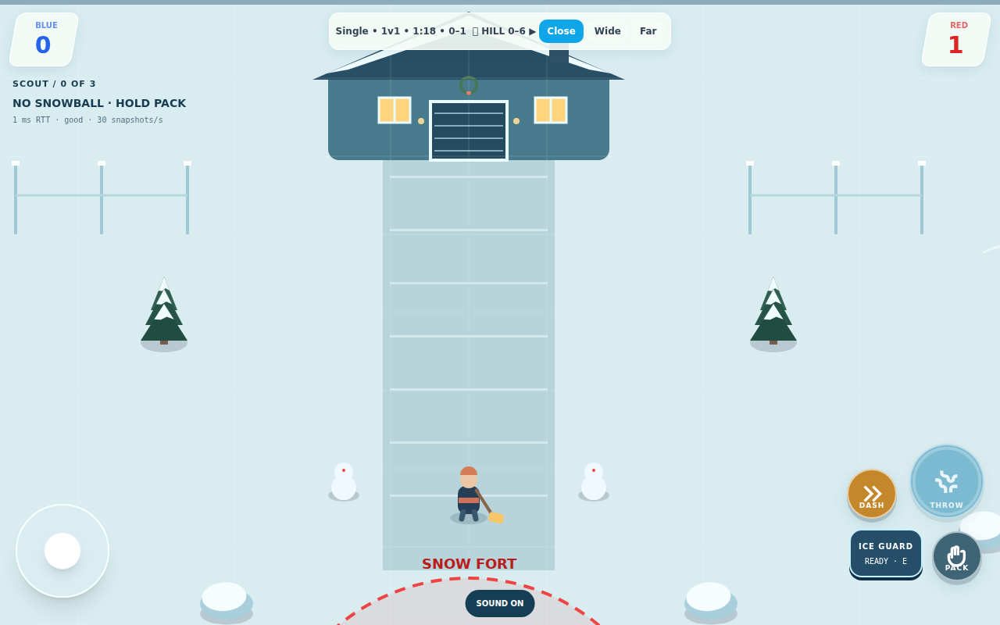

# Neighborhood Snow Day

A residential setting for the existing 90-second SnowFight hill battle. Teams still bank hill points, throw, freeze and rescue; classes, private rooms and overtime retain their existing behavior.

## Arena

A house, driveway and shoveling parent sit just north of the center objective, now marked with a snow-fort flag. A street crosses the center of the map. Twenty pieces of mirrored cover create matching approaches on both sides, with small mirrored per-match variation. Cover is authoritative collision geometry shared with all clients; the street, house, driveway, fences and parent are visual scenery and do not block movement or alter speed. Existing player-built igloos retain their behavior.

The parent shovels in an animation keyed to the room's server ticks. A snowball passing close to the parent triggers a brief room-scoped reaction, limited to once every three simulated seconds. The parent does not absorb or deflect balls, freeze, score, or affect a match outcome. There is no physical snow deformation or cooperative rescue mode in this change. Reduced motion stops the shovel swing.

Map tests check mirrored collision objects, clear hill/spawn lanes and a path into the objective across 30 generated layouts. A server test checks that a nearby snowball produces a single cooldown-limited reaction while continuing its flight and leaving scores unchanged. Browser smoke checks cover existing mobile controls and characters. The included visual preview is a local debug camera view, not a separate published game.

## Review notes

Based on main 5449bd9. PR #14's separate room-link and hill-transfer fixes are not merged into this branch; both remain important before release. Real phone and laptop playtesting, two-network latency testing, arena balance across classes and team sizes, and an independent full-match playtest remain necessary. No production deployment is included.

