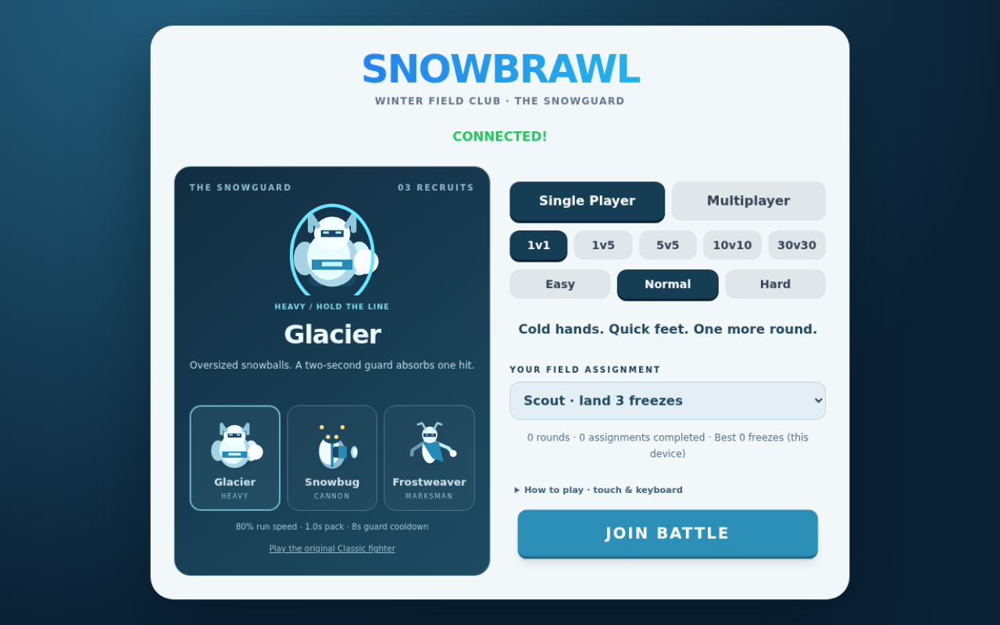
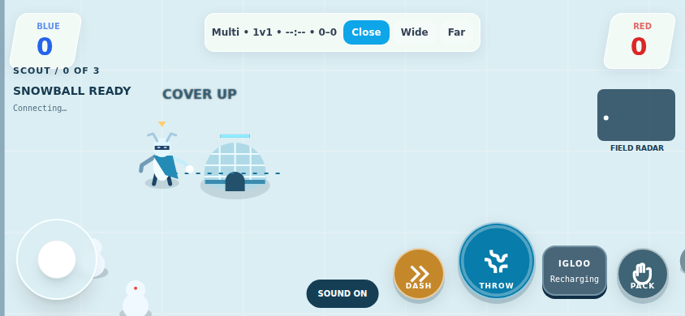

# The Snowguard — playable character expansion

Based on main `6a7d3abf1ac61e7cd2c44430e8db1e2b76f32e21`, including PR #8's overtime-preserving integration. This is an additive character update; Classic remains selectable and clients that omit or send an invalid class get Classic.

## Three recruits

| Recruit | Primary throw | Special (E / touch button) | Tradeoff |
| --- | --- | --- | --- |
| Glacier | Oversized snowball, 1.65× radius, 0.9× shot velocity | Ice Guard: absorbs one hit during a 2-second window; 8-second cooldown | 80% run/dash speed; 20px body radius; 1-second packing |
| Snowbug | Three snowballs; charge narrows the spread | Cannon: one 13px-radius, 24px/tick shot; consumes the held snowball; 7-second cooldown | 95% run/dash speed; 16px body radius; 65-tick packing |
| Frostweaver | Narrow snowball, 1.4× shot velocity | Build igloo 90px ahead: blocks players and all shots, 3 hits, 8-second lifetime, 12-second cooldown | 13px body radius; fast 108% movement but smaller projectile; 50-tick packing |

Charge still increases velocity and ball size. Each volley consumes **one** packed snowball and counts as one throw; each target freeze counts toward score. No splash damage, piercing, health bars on fighters, or persistent stat upgrades. Existing five-second thaw and sudden-death rules remain intact. A blocked hit on Glacier is not a freeze and cannot win overtime.

The Snowbug is a six-legged snow beetle with a rotating cannon and recoil. Glacier has a broad snow-and-ice body, shoulder armor, and a readable guard ring. Frostweaver has a slender scarf silhouette, long branch-like arms, and antler details. Canvas art is shared between the selection portraits and the battlefield, with team colors and freezing overlays. No new texture CDN or image downloads.

## Igloo rules and feedback

The entire dome is solid; its dark doorway is decorative, not an entrance. Igloos can be damaged by either team's shots. A placement footprint shows clear/blocked space; the server makes the final decision. Build fails without using cooldown when the position intersects a player, obstacle, another structure, or world boundary. Maximum one igloo per owner and twenty per room. Cover expires in simulation ticks, disappears when its owner leaves, and stops changing after match end. Damage cracks, health pips, shatter particles, and build feedback expose its state.

## Protocol and performance

Join accepts `classId: classic | glacier | snowbug | frostweaver`. Init returns validated `classId` and server class tuning. The input extension is a boolean `ability` edge. State adds class/cooldown/guard fields to players, projectile `kind`, and a bounded `structures` list. Inputs cannot switch class mid-match or supply weapon stats. Frozen players, finished matches, cooldowns and missing ammunition are rejected server-side. Build denial has a small direct response to the requesting player.

Mixed bot classes are enabled when a new recruit is selected in single player. Classic single-player retains the original bot roster and behavior. Multiplayer remains humans only. Bot and human attacks share the same firing and ability functions.

Simulation remains 60Hz; snapshots remain 30Hz, falling to 2Hz after match end. New visuals are local canvas drawing and reuse the existing bounded particle and popup lists. Each Snowbug volley is capped at three balls. No new frame-rate-dependent network stream or physics loop is added.

Local stress probe: 60 mixed-class bots, 1,800 synchronous simulation ticks including snapshot JSON serialization. Observed p50 0.239ms, p95 0.957ms, maximum 46.532ms, peak 26 projectiles; average full snapshot 32,548 bytes. This is a single unpaced local run, including startup/JIT effects, **not** a real-device, sustained-load, WAN or FPS benchmark. Full snapshots still carry substantial bandwidth in 30v30. Mobile/WAN profiling and delta or interest-managed snapshots remain follow-up work; no claim of lower Internet RTT is made.

## Review and tests

- `npm test --prefix backend`: 39 passed, including ten deterministic class regressions and all existing overtime/game-mode/network tests.
- `backend/tests/browser-smoke.cjs`: existing two-thumb controls, throw/pack/cancel, final results and rematch. The short test now caps overtime at 60 ticks; production overtime is unchanged.
- `backend/tests/recruits-browser.cjs`: selection and server-confirmed touch abilities for all three recruits, cooldown rejection, igloo creation, portrait/landscape/desktop layouts, and no JavaScript exceptions.
- Inspect 390×844 portrait, 844×390 landscape, and 1280×800 desktop. The menu scrolls on shorter screens. Abilities support the E key and a dedicated touch button; the ability button also supports native keyboard activation. Reduced-motion disables idle preview bobbing.

Browser scripts use the Playwright setup documented in MOBILE_GAMEPLAY_REVIEW.md. Start locally with `cd backend && npm ci && npm start`; open localhost:3000. Ship frontend, new assets, `classes.js` and backend together. Physical iOS/Android playtesting, class balance and high-latency multiplayer testing remain necessary. No merge or deployment is performed by this change.

## Review captures

